<div align="center">


### Sacamos a la IA del chat y la pusimos en una pizarra.

**🥈 2.º lugar · Build & Pitch 2026** — el hackathon más grande de Guatemala<br>
+300 personas registradas · 46 equipos · Universidad del Valle de Guatemala


-000000)


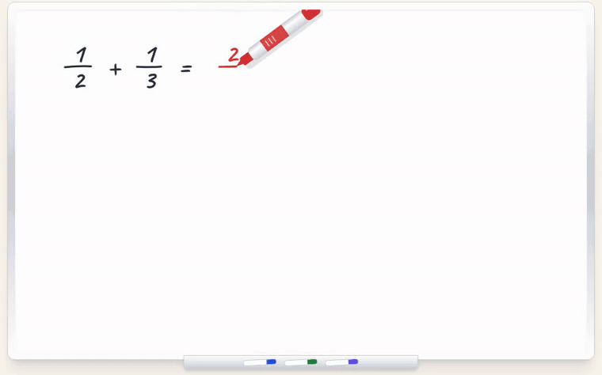

</div>

---

**Trace** encuentra el paso exacto donde un alumno se equivocó en su hoja de papel y le da una clase en una pizarra: un marcador escribe y dibuja mientras una voz explica. Si se pierde, **levanta la mano frente a la cámara** y la pizarra se detiene, se lo explica de otra forma y sigue.

> **English TL;DR** — Trace takes AI out of the chat and puts it on a whiteboard. Teachers photograph students' handwritten work; Trace pinpoints the exact step where each student went wrong, groups the class by error type, and gives every student a voice-narrated, hand-drawn whiteboard lesson about *their* mistake. Students can interrupt by raising their hand on camera. Built in one day by a team of four; 2nd place out of 46 teams at Build & Pitch 2026, Guatemala's largest hackathon.

---

## 🏆 Segundo lugar en Build & Pitch 2026

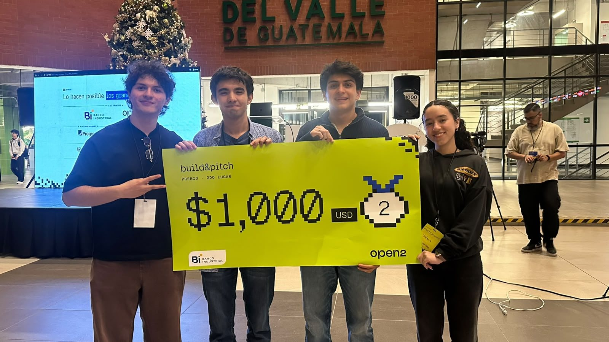

El 21 de noviembre de 2026, en la **Universidad del Valle de Guatemala**, construimos Trace en un solo día para el track **EdTech** de [Build & Pitch](https://www.open2.io/build-and-pitch), organizado por **open2**. Entre más de 300 personas registradas y **46 equipos**, quedamos en **segundo lugar** y ganamos **USD 1,000**.

<details>
<summary>📸 Más fotos</summary>
<br>
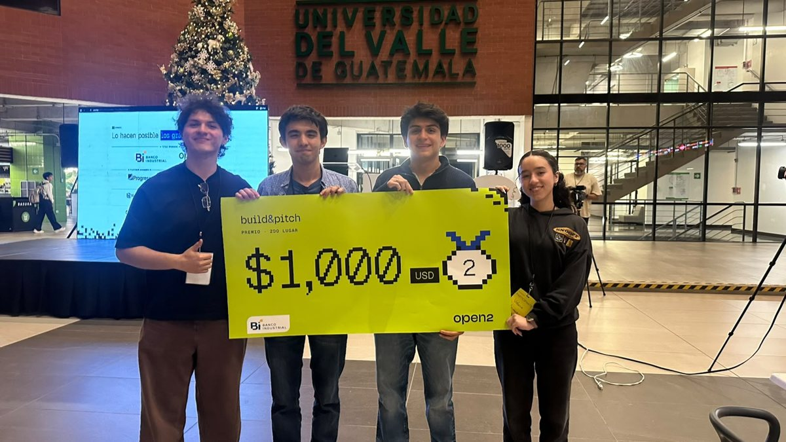
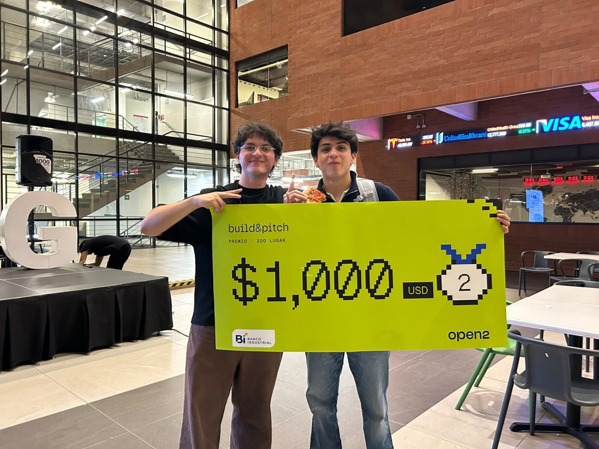
</details>

---

## 📉 El problema

> *"Científicamente, estamos pisados."*

En **PISA 2025**, solo **8 de cada 100** jóvenes guatemaltecos de 15 años alcanzaron el nivel mínimo en matemáticas.

- Una docente con **40 alumnos** y un solo plan de clase no puede saber a tiempo **quién** se perdió ni **en qué paso**.
- En matemáticas cada tema se construye sobre el anterior: el que no entiende fracciones hoy, mañana no entiende álgebra. **Sin que nadie lo note, se queda atrás.**
- La IA debería ayudar, pero enseña con **muros de texto**. Los alumnos que estudian con un chat sin guardas rinden **17 % menos** cuando se lo quitan ([Bastani et al., *PNAS* 2025](https://knowledge.wharton.upenn.edu/article/without-guardrails-generative-ai-can-harm-education)).

**Llevamos años adaptándonos a la forma en que la IA nos enseña. Trace hace lo contrario: trae la IA a nuestra forma de aprender**, viendo a alguien explicar en una pizarra y pudiendo levantar la mano.

---

## ✏️ Cómo funciona

Trace tiene **dos puertas** que comparten el mismo motor. Primer tema: **suma de fracciones con distinto denominador** (1ro básico).

### 1. En el aula, con la profe

La profe deja un ejercicio, sube la respuesta correcta y le toma foto a las hojas que sus alumnos resolvieron **a mano**. Trace lee la letra, encuentra **el paso exacto** del error de cada uno y arma un **semáforo** del salón agrupado por tipo de error, no por nota. La profe siempre puede confirmar o corregir el diagnóstico.

| Semáforo del salón | La hoja de cada alumno, con el error marcado |
|---|---|
| 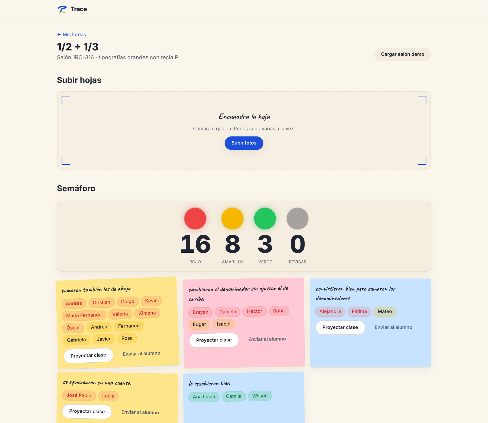 | 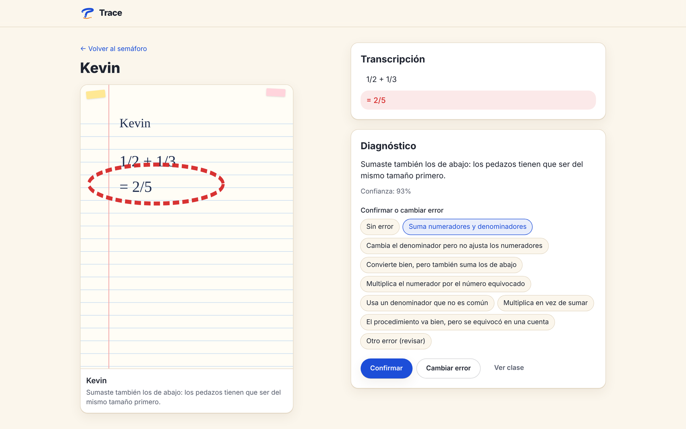 |

### 2. La Pizarra Viva

Cada alumno recibe una clase sobre **su** error y con **sus** números. Un marcador escribe, dibuja tortillas y barras de fracción y encierra su respuesta en rojo, mientras una voz le explica. Si se pierde, **levanta la mano** o dice *"no entendí"*: la pizarra se detiene a medio trazo, le explica con otra representación en una hoja aparte y retoma donde iba.

| La clase | "Te escucho…" | Otra forma de explicarlo |
|---|---|---|
| 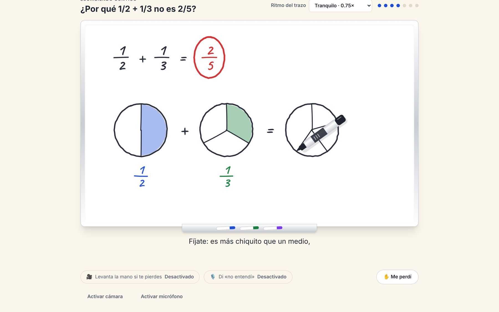 | 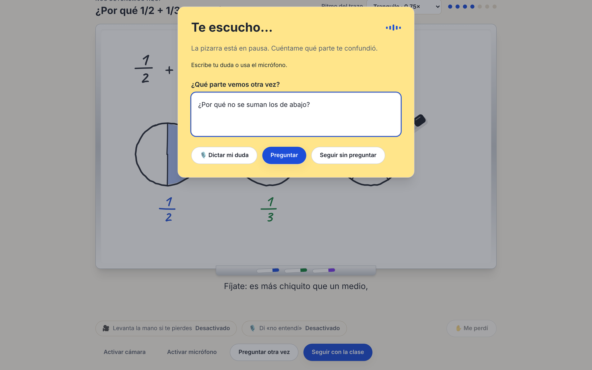 | 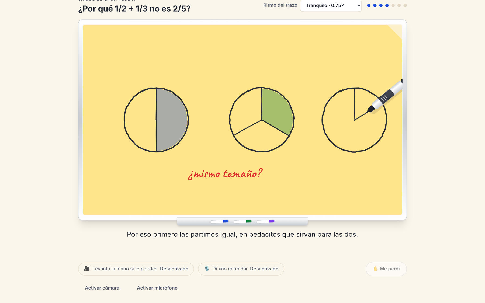 |

### 3. En casa, el alumno solo

Sin esperar a la profe, el alumno puede pedir **"Ponme un problema"** (lo resuelve en papel, sube la foto, ve su error y recibe la clase) o **"No sé nada, explícame"** (tres preguntas rápidas detectan desde dónde empezar). Todo lo que practica aparece en el semáforo de su profe, y cuando demuestra que entendió, **pasa a verde**.

<p align="center">
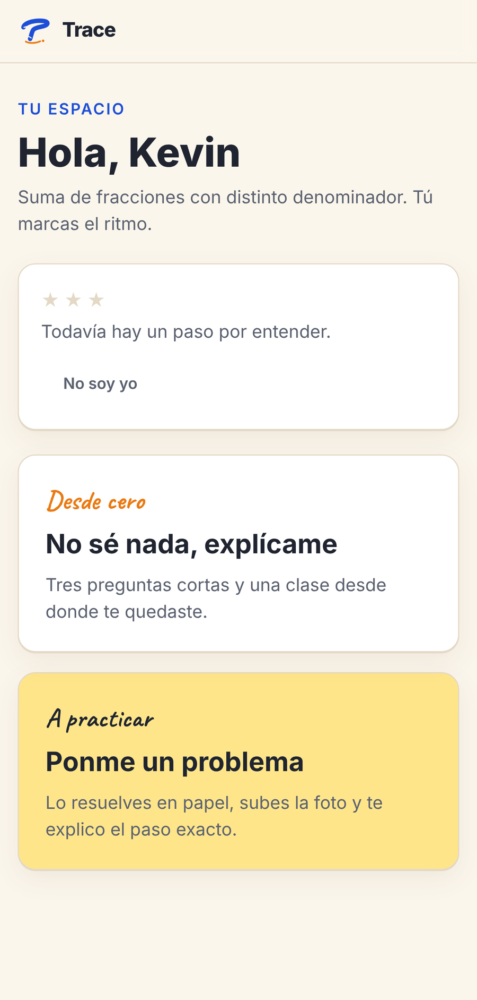
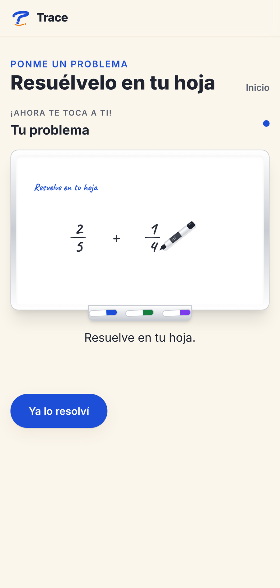
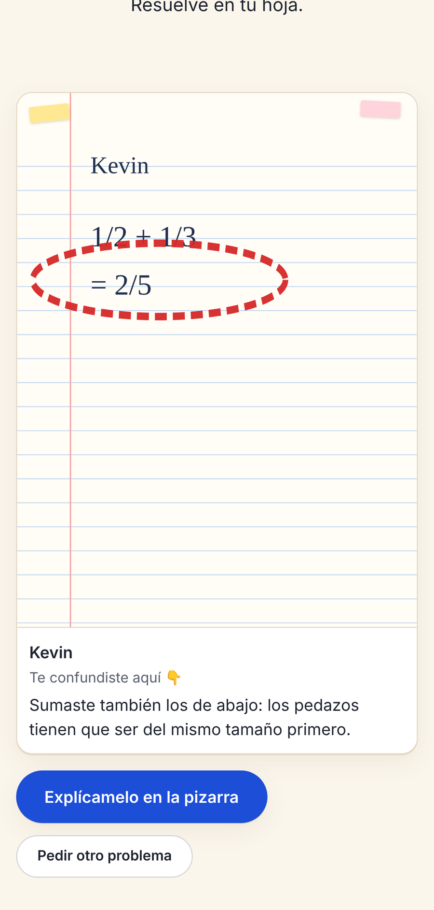
</p>

---

## 🧠 Arquitectura

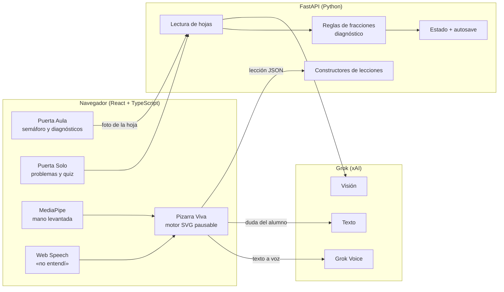

**Decisiones clave:**

- **Diagnóstico híbrido.** Grok **solo transcribe** la hoja (rápido y confiable) y un **motor de reglas de fracciones** decide el error, el renglón equivocado y dónde dibujar el círculo rojo. Si algo no cuadra, la hoja va a la columna "Revisar" de la profe en vez de inventar un diagnóstico.
- **Lecciones generadas por código, no por IA.** Cada tipo de error tiene un constructor que arma la clase con los números reales del alumno: funciona **sin internet** y nunca dibuja fuera de la pizarra. Grok se usa donde aporta: aclaraciones cuando el alumno interrumpe y evaluar su explicación final.
- **Pizarra propia sobre SVG.** Escritura a mano letra por letra, fracciones, tortillas, barras y flechas, con un marcador que sigue el trazo. Todas las animaciones se pueden **pausar a medio trazo** y reanudar exactamente donde quedaron.
- **Privacidad.** La detección de la mano corre **en el navegador** con MediaPipe; el video nunca sale del dispositivo.
- **Un solo servicio.** Un Dockerfile multi-etapa compila el frontend y lo sirve desde FastAPI: una URL, HTTPS y un volumen persistente para el estado.

### Stack

| Capa | Tecnología |
|---|---|
| Frontend | React 18, TypeScript estricto, Vite, Tailwind CSS, Framer Motion, TanStack Query |
| Interacción | MediaPipe Tasks Vision (gestos y landmarks de la mano), Web Speech API |
| Backend | Python 3.11, FastAPI, Pydantic v2, Pillow |
| IA | Grok (xAI) · Responses API con visión, texto y Grok Voice (texto a voz) |
| Infraestructura | Docker multi-etapa, Railway, volumen persistente |

---

## 🚀 Correr localmente

```bash
git clone https://github.com/JordiCardona7/build-and-pitch.git
cd build-and-pitch
cp .env.example .env            # pon tu XAI_API_KEY (opcional: sin llave funciona con datos de ejemplo)

# Backend
cd apps/api
pip install -r requirements.txt
uvicorn app.main:app --reload --port 8000

# Frontend (en otra terminal)
cd apps/web
npm install
npm run dev                     # http://localhost:5173
```

- **Sin backend:** `VITE_USE_MOCKS=true npm run dev` usa datos de ejemplo generados desde el backend real.
- **Probar la llave de Grok:** `cd apps/api && python -m scripts.check_grok`.
- **Pruebas:** `cd apps/api && pytest -q` · `cd apps/web && npm run check`.
- **Despliegue:** ver [`docs/DEPLOY.md`](docs/DEPLOY.md).

---

## 🛠️ Cómo lo construimos en un día

Éramos 4 personas, cada una trabajando con su propia IA de programación, en el mismo repositorio y al mismo tiempo. Para no estorbarnos:

- **Primero el plan, después el código.** Un [PRD](PRD.md) con el problema, el alcance y el guion de la demo.
- **Contratos congelados.** [`docs/CONTRACTS.md`](docs/CONTRACTS.md) define tipos, endpoints y el formato de las lecciones, con datos de ejemplo para que nadie esperara a nadie.
- **Cada carpeta tiene un dueño.** [`docs/WORKFLOW.md`](docs/WORKFLOW.md) y `CODEOWNERS` evitaron conflictos; ramas cortas y PR pequeños.
- **Instrucciones para las IAs.** [`AGENTS.md`](AGENTS.md) y [`docs/roles/`](docs/roles) le dicen a cada IA qué construir, con qué criterios y qué archivos no tocar.
- **Diseño con identidad.** [`docs/DESIGN.md`](docs/DESIGN.md) define el estilo "escolar cálido": papel crema, notas adhesivas y marcadores.

---

## 📚 Respaldo científico

- **Ver dibujar enseña más que ver el resultado terminado**, y la mano visible importa — Fiorella & Mayer (2016).
- **Ver una explicación dibujada en vivo y luego explicarla con tus palabras** produce efectos grandes — Fiorella, Stull, Kuhlmann & Mayer, *Journal of Educational Psychology* (2020).
- **Voz + imagen supera al texto en pantalla**, y segmentar al ritmo del alumno mejora el aprendizaje — principios de aprendizaje multimedia de Mayer.
- **La IA sin diseño pedagógico se vuelve muleta** — Bastani et al., *PNAS* (2025).

---

## 👥 Equipo

| | Rol |
|---|---|
| **Jordi Cardona** · [@JordiCardona7](https://github.com/JordiCardona7) | Backend, IA y diagnóstico de hojas · despliegue |
| **Sergio** · [@S3rgi07](https://github.com/S3rgi07) | Pizarra Viva: motor de trazo y reproductor de lecciones |
| **Tony** · [@its-tony](https://github.com/its-tony) | Diseño, sistema visual y experiencia del docente |
| **Valeria** · [@vaalss](https://github.com/vaalss) | Voz, interrupción por mano y voz, experiencia del alumno |

**Gracias** a [open2](https://www.open2.io) por organizar Build & Pitch, a la **Universidad del Valle de Guatemala** por recibirnos, a **Banco Industrial** y a todos los patrocinadores, y a los mentores que nos ayudaron a enfocar la idea.

---

<div align="center">

**Trace — para que ningún alumno se quede atrás.**

Licencia [MIT](LICENSE) · Hecho en Guatemala 🇬🇹

</div>
